<<<<<<< HEAD
# Brazil E-commerce Analytics

[](https://www.python.org/)
[](https://pandas.pydata.org/)
[](https://seaborn.pydata.org/)
[](#roadmap)

Exploratory and visual analysis of the Brazilian Olist marketplace, built with Python, Pandas, Seaborn, and Matplotlib.

This project transforms multiple transactional tables into an executive view of sales, logistics, payment behavior, and customer satisfaction.

> **Scope note:** the public Olist dataset primarily covers operations between 2016 and 2018. The 2024 dates from some original examples were replaced with the actual period covered by the data.

## Executive Summary

| # | Question | Test | Main result | Limitation |
|---|----------|------|-------------|------------|
| 1 | How do orders evolve month by month? | Descriptive trend | Steady growth from January 2017 | 2016 has very few orders (platform launch) |
| 2 | How long does a delivery take? | Descriptive | Median 10 days, mean 12.1, 8.1% late | 288 orders take over 60 days (outliers) |
| 3 | Do late deliveries lower review scores? | Mann-Whitney U | Median 2 vs 5 stars (p < 0.001) | Association, not causation |
| 4 | Does cancellation vary by state? | Chi-square, Cramér's V | Significant difference (p = 0.006), V = 0.022 | Very weak effect |
| 5 | Are late deliveries concentrated by region? | Chi-square, Cramér's V | North and northeast have more late deliveries (V = 0.13) | Only states with 100+ orders |
| 6 | Does delivery-time variability differ by state? | Levene, Kruskal-Wallis | Unequal variances (p < 0.001), ε² = 0.248 | ANOVA not valid |
| 7 | Does price change by product category? | Levene, Kruskal-Wallis | Significant differences (H = 13136) | Only categories with 100+ items |
| 8 | Did average order value rise from 2017 to 2018? | Mann-Whitney, Welch, Cohen's d | No change in the mean (d = 0.008) | 2018 is incomplete |
| 9 | Is there a Simpson's Paradox across states? | Comparison by category | No reversal in all categories | Only the 10 largest categories |
| 10 | Which factors predict late delivery? | Logistic regression | Distance OR = 1.014 per 100 km; pseudo R² = 0.028 | The estimated delivery date is set by the platform |
## Data Model

The analysis integrates the following files from the Olist dataset:

| Table | Purpose |
|---|---|
| `olist_orders_dataset.csv` | Order status, dates, and lifecycle |
| `olist_order_items_dataset.csv` | Products sold, price, and freight |
| `olist_order_payments_dataset.csv` | Payment methods, installments, and value |
| `olist_order_reviews_dataset.csv` | Ratings and comments |
| `olist_customers_dataset.csv` | Customer location |
| `olist_products_dataset.csv` | Product categories and attributes |
| `olist_sellers_dataset.csv` | Seller information |
| `olist_geolocation_dataset.csv` | Coordinates and geographic location |
| `product_category_name_translation.csv` | Category name translations |

Source: [Brazilian E-Commerce Public Dataset by Olist](https://www.kaggle.com/datasets/olistbr/brazilian-ecommerce)

## Project Structure

```text
BrazilEcommerce/
├── BrazilEcommerce.py                 # Data cleaning, integration, and visualizations
├── sql_BrazilEcommerce.py             
├── olist_*.csv                        # Input data
├── product_category_name_translation.csv
├── Brazilec1.png ... Brazilec10.png   # Exported visual results
└── README.md
```

## Cleaning decisions

- Missing delivery dates were not filled: they correspond to canceled or in-process orders.
- Product measurements were filled with the median; missing category names were filled with desconocido.
- One review per order was kept (the most recent).
- Zip codes were normalized to 5 digits to join customers, sellers, and geolocation.
- Orders with impossible distances (> 4300 km) were excluded: 4 cases.
- we can analize that products and orders are clear of duplicates, 
# but city has (261831 duplicates), and checking the nulls city is ok but orders has (2965,1783. and 160) 
# and products has (610  in four)
- ## Nouticing several duplicates and nulls(city had 261831 duplicates, 
# which i dropped them and orders has 2965,1783. and 160 nulls, 
# products has 610 nulls in four columns), analizing nulos canceled(619), 
# unavailable(609),invoiced(314),processing(301),created(5),approved(2),, 
# some very data strangers(8) they should be in delivery date .


### Question 4 — Cancellation rate by state

This question is evaluated with a chi-square test and Cramér's V; the current analysis does not create a chart.

### Question 5 — Late deliveries by state

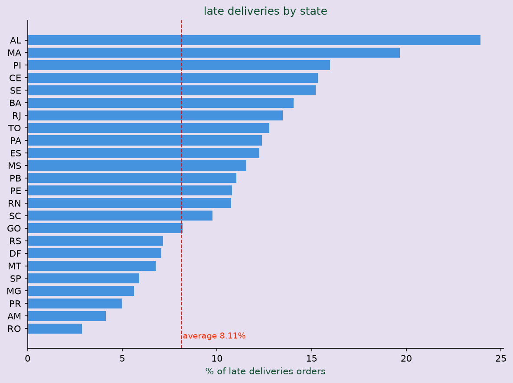

### Question 6 — Delivery-time variation by state

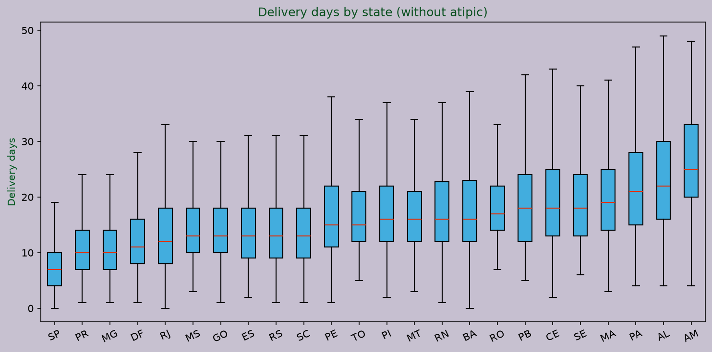

### Question 7 — Product prices by category

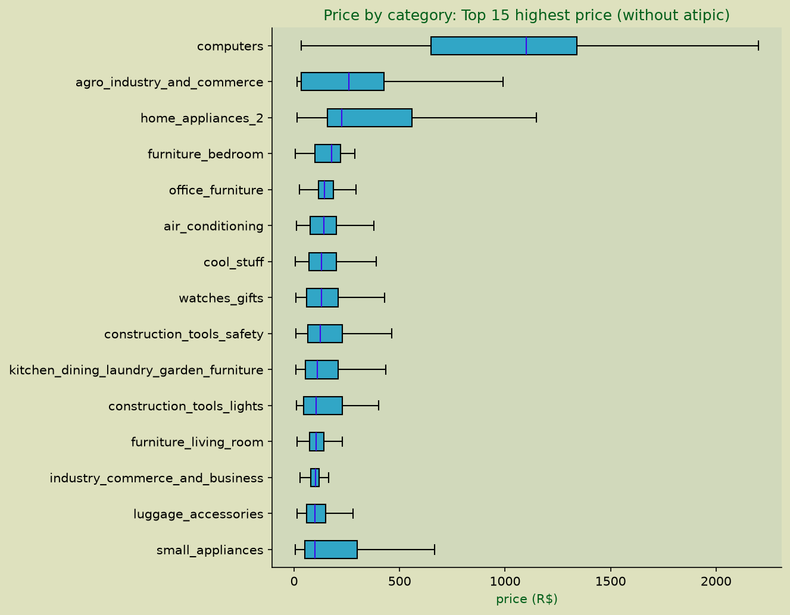

### Question 8 — Average ticket, 2017 vs. 2018

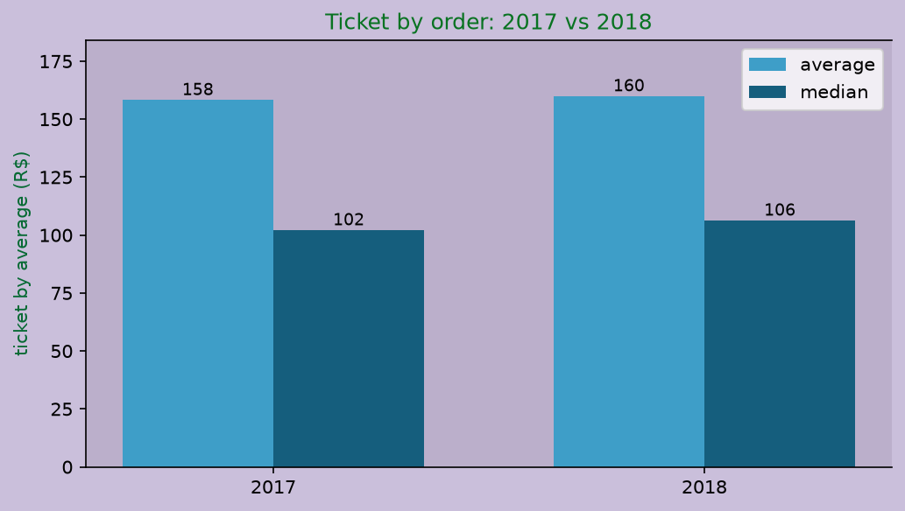

### Question 9 — State comparison by product category

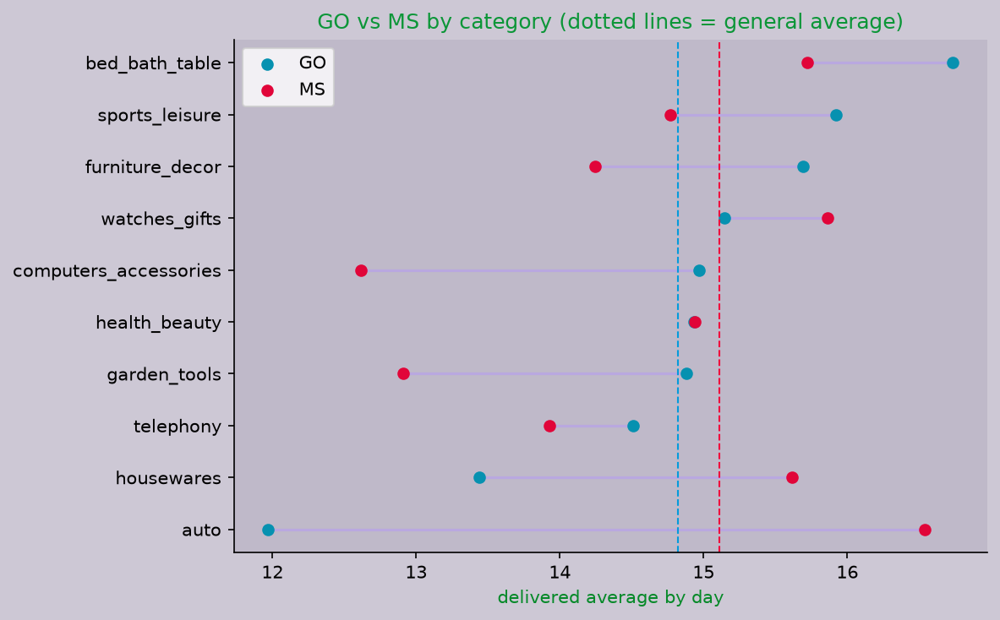

### Question 10 — Late-delivery rate by seller-customer distance

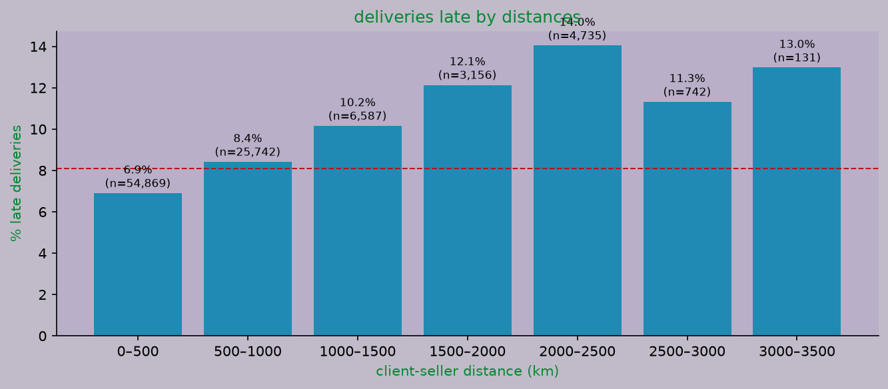

| Delivery delay | Commercial value distribution |
| |

| City comparison | Monthly evolution |
| 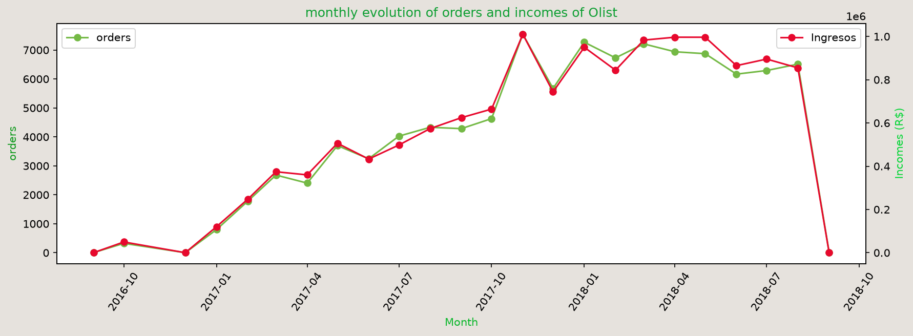 |

### Sales and Customers

| Payment methods | Rating distribution |
|---|---|
|  |

| Value by rating | Delivery punctuality |
|---|---|
| 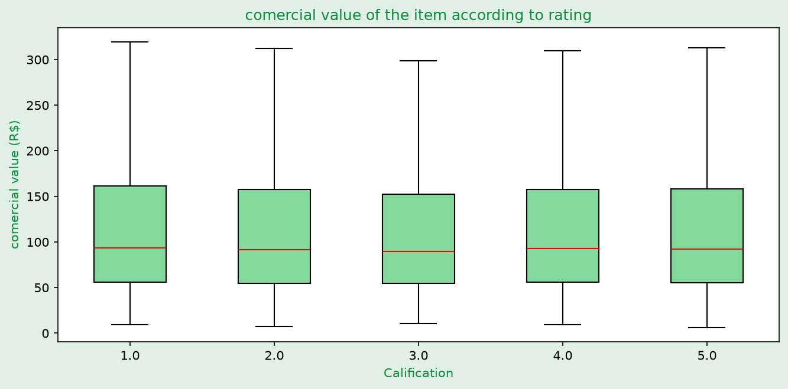 | 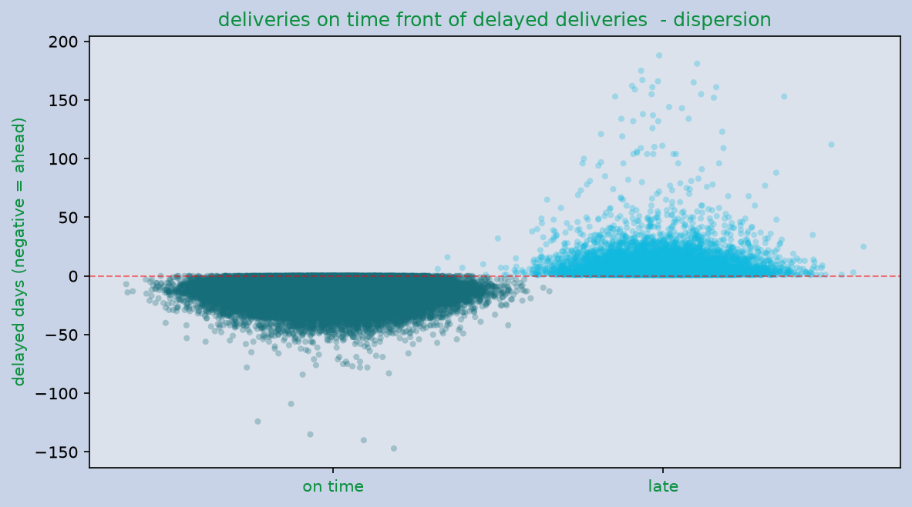 |

Run `python BrazilEcommerce.py` to regenerate the ten images in this gallery.

## Business Question Analysis

These figures are generated by the analysis sections in `BrazilEcommerce.py`.

### Question 1 — Monthly order trend

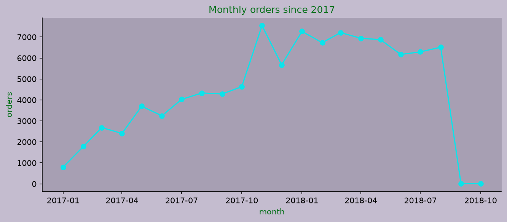

### Question 2 — Delivery-time distribution

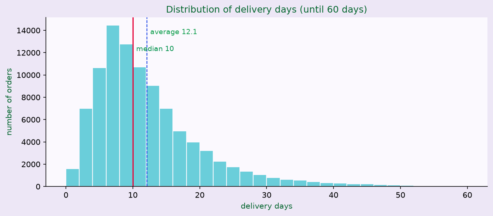

### Question 3 — Review scores for late and on-time deliveries

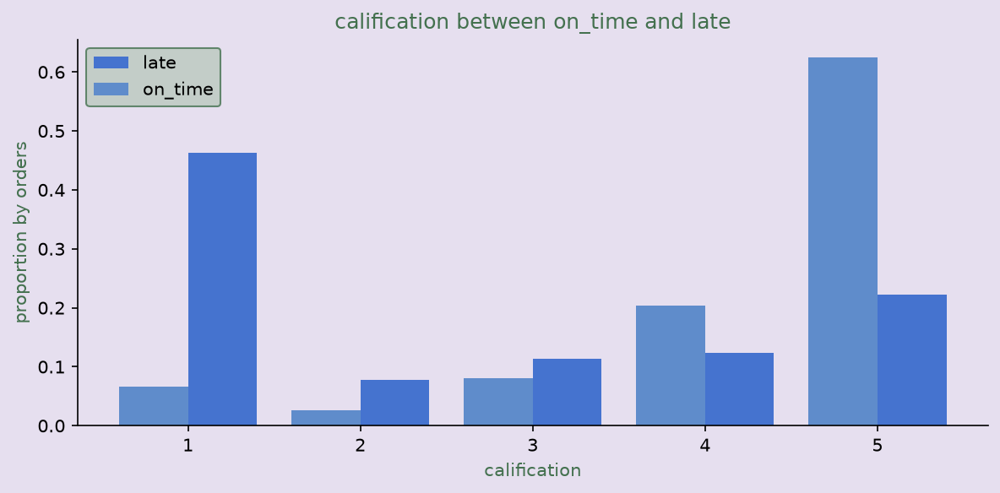


The logistic regression for Question 10 is reported as a coefficient and odds-ratio table in the script, rather than as a chart.

## Methodology

1. Load CSV files with Pandas.
2. Convert dates, prices, freight, payments, and ratings to appropriate data types.
3. Integrate orders with items, customers, products, geolocation, payments, and reviews.
4. Create derived metrics:
   - `item_value = price + freight_value`
   - delay compared with the estimated delivery date
   - orders, revenue, and average order value by period and location
5. Build visualizations for commercial, customer experience, and logistics analysis.

Delay is calculated in days as:

```text
order_delivered_customer_date - order_estimated_delivery_date
```

A positive value represents delivery after the estimated date; a zero or negative value represents an on-time delivery.

## Initial Findings

- Late deliveries (8.1%) are concentrated in the north and northeast, and rise with the distance between seller and customer.
- Late delivery strongly lowers customer review scores, the largest impact on satisfaction in this dataset.
- Average order value and cancellation rates barely vary across states or years.
- The dataset's variables explain very little of the delays: most of the variation depends on operational factors not captured in the data.
- delivered delay around (10 days), average(12), the 75% arrive in around (15 days), 
# and 25 around (6 days) the (8.11 % delay deliveries), 288 orders delayed more than 60 days with(0.3%), 
# limitation 8 orders with status delivered that not have customer_date they are keeping in delivered counts but not in stadistics days.
- diagnosis "the orders delievered after the stimated_date have significate califications lower(median(2 vs 5):
#  mann-whitneyu U,p < 0.001) is an association, no causation,,
#  delivered_orders also can have others problems, like damages products, lacking of information from deliveries, 
# for rushtime also would be a problem but dont have the dataset to know that others. "
- the cancelation rate change significantly between (chi2 = 47.71, p=0.006),
# but the association is weak (v_cramer = 0.022) rates are between 0.47% and 1.19%,
# so state is not very relevant to predict cancelations, states with rates higher (RO, PI)
# have small trails an the diference in some cancelations can change their percentage. 
- analizing late deliveries are concentrated in several states(chi_2 =1623, p<0.001, ve of cramer=0.13)
# highest rates are in north and west regions of Brazil (Alagoas 23.9%) in fron to an average of (8.1%)
# association is moderate: region explain a part of the delayed but not at all 
# west states have also bigger distances toward distribution center.
- Delivery time of variability is not equal between states (levene W=162.83, p < 0.001)
# so ANOVA is not valid, was using kruskal-wallis which also fond out differences significantly in the distribution
# (H=23864.96, p < 0.001), size effect is big (E2=0.248)
# states slowest and spread are (AM, AL, CE), most fastest and consistents are (DF and MA)   
- price's products change significantly between categories (kruskal-wallis H=13136.01, p < 0.001, levene W=112.69, p < 0.001 because ANOVA didn't use it)
# computers has the highest price (median= 1100), while watches-gifts combine the bigger volume with moderate prices.
# the difference between average and median in several categories show what there are products with very very high price into them,
# so the median describe the best common price.
- Average ticket by order was actually the same in (2017(158.37) - 2018(160.04))
# with one noutible size (d=0.008, welch p < 0.24)
# the median increase of (102 to 106)(Mann-whitneyu p < 0.001) a little bit change it.
# Mann-whitneyu compare distributions not averages, in spite of this can be significantly when welch doesn't
# the number of orders was growing up (45101 in 2017  and 54011 in 2018), although 2018 is incomplete.
- Analizing the counts i nouticed there was not relevant simpsoms paradox 
# no state of pair inverts his order in every analized categories, the highets inversion pairs
# (GO-MS, MT-PE, with six of ten all over categories), they have general differences lower to (0.35 dyas)
# so the order change is just nothing noise and not a structural inversion.
# north states are consistently lower and SP is consistently the fastest.
- the probability of late delivery increasing with the distance between client-seller
# (6.9% until 500km, 10.2% until 1000 and 1500km, 14.0% until 2000 and 2500km)
# after 2500 km the rate become stable between 11% and 13%.
# the block of 3500 and 4000km (33%) have just (3 orders)and its not ocnsiderted 
# its a clear association but the distance doesn't explain all the late deliveries
# was lost just (4) orders of (95992) and its just wrong coordinates not real datas so dont change the analysis (so they are just exclude by distance >4300)   
- in the logistic model, the distance seller-client increase the late delivered probability
# but his adjust effect is small (OR=1.014 por 100km, p < 0.001)
# client state is the strongest factor,, Alagoas has 9 times odds bigger than reference
# price has a slow effect (OR=1.02 by R$100) and the carriage is not significantly
# as a limitation: the variable late just compare delivery vs stimated_date so that date is calculated by the platform using region and distance
# pseudo R2  of McFadde=0.028 coeficients are significatives by size trail this help us how predict patterns not to predict what order willl arive late or doesn't it


> Final conclusions will be added after reviewing the aggregated metrics and exported visualizations.

## Business Questions

|1. How do orders and sales evolve month by month?
#    Data: orders + order_items. Technique: time grouping and trend analysis.
#
# 2. How long does a delivery take on average, and how is that time distributed?
#    Data: orders + customers + city_clean. Technique: delivery_days = customer_date - purchase_date;
#    mean, median, percentiles and outliers.
#
# 3. Do late deliveries lower customer review scores?
#    Data: orders + order_reviews. Technique: Mann-Whitney U test (review scores are ordinal, not normal).
#
# 4. Which order statuses have the highest cancellation rate?
#    Data: orders + customers + city_clean. Technique: contingency tables, chi-square test, Cramér's V.
#
# 5. Are late deliveries concentrated in certain regions?
#    Data: orders + customers + city_clean, with late = delivered after estimated date.
#    Technique: chi-square test and Cramér's V.
#
# 6. Is delivery-time variability the same across states?
#    Data: orders + customers + city_clean. Technique: Levene's test for equal variances.
#    If variances differ, use Kruskal-Wallis instead of ANOVA.
#
# 7. Does average product price change by product category?
#    Data: order_items + products + category translation. Technique: ANOVA or Kruskal-Wallis,
#    depending on the assumptions checked with Levene's test.
#
# 8. Did average order value increase from 2017 to 2018?
#    Data: orders + order_items. Technique: Welch's t-test or Mann-Whitney U, plus effect size.
#
# 9. Simpson's Paradox: does the ranking of states change when we split by category?
#    Data: orders + order_items + products + customers + city_clean.
#    Technique: compare average delivery time by state overall, then within each category.
#    If the ranking reverses, we have Simpson's Paradox.
#
# 10. Which factors predict a late delivery?
#     Data: all of the above + sellers, with seller-customer distance computed from
#     geolocation coordinates (Haversine formula).
#     Technique: Spearman correlation between distance and delivery days, and logistic
#     regression with late as the target variable.

## Technologies

 pd 
 np
 sns
 plt
 display
 mannwhitneyu, ttest_ind
 chi2_contingency
 levene
 kruskal
 levene, kruskal, f_oneway
 combinations
 sm

## How to Run

Install the dependencies and run the file from top to bottom:

### 1. Clone the repository

```bash
git clone https://github.com/andreslogan1103-crypto/BrazilEcommerce.git
cd BrazilEcommerce
```

### 2. Create and activate a virtual environment

Windows PowerShell:

```powershell
python -m venv .venv
.\.venv\Scripts\Activate.ps1
```

### 3. Install dependencies

import pandas as pd 
import numpy as np
import seaborn as sns
import matplotlib.pyplot as plt
from IPython.display import display
from scipy.stats import mannwhitneyu, ttest_ind
from scipy.stats import chi2_contingency
from scipy.stats import levene
from scipy.stats import kruskal
from scipy.stats import levene, kruskal, f_oneway
from itertools import combinations
import statsmodels.api as sm

### 4. Run the analysis

```powershell
python BrazilEcommerce.py
```
The script opens the generated Matplotlib figures. Close the figure windows when you finish reviewing them.

## Data Quality Notes

- `price`, `freight_value`, `payment_value` and `review_score` are converted explicitly to numeric values.
- Missing delivery dates are excluded from delay metrics.
- The geolocation table can contain repeated postal-code prefixes; the visualization flow keeps one geolocation record per prefix to avoid multiplying rows during the city join.
- The current city-level visualization uses the top 15 cities by item volume to preserve readability.
- `economic_indicators` in `BrazilEcommerce.py` is a small illustrative table for demonstrating a merge by state and year. It should not be presented as official Brazilian GDP, inflation or unemployment data.

## Roadmap

- [x] Integrate transactional datasets.
- [x] Add commercial, customer and logistics visualizations.
- [x] Export and document the first visual gallery.
- [ ] Add exact KPI tables for the executive summary.
- [ ] Add translated product category labels.
- [ ] Separate the analysis into reusable functions or notebooks.
- [ ] Add automated tests for transformations and metrics.
- [ ] Add an interactive dashboard with Streamlit or Power BI.

## Author

 [(Camilo Andres Delgado)] 
Data Analytics Portfolio | Python | Business Intelligence

Connect with me on [LinkedIn](https://www.linkedin.com/in/camilo-andres-delgado-galvis-913b83300) and explore the complete analysis on [GitHub](https://github.com/andreslogan1103-crypto).

## License and Dataset Attribution

This repository is an educational and portfolio analysis based on the public Olist dataset. Review the original dataset page and its terms before redistributing the data or derived artifacts.
=======
# Brazil E-commerce Analytics

[](https://www.python.org/)
[](https://pandas.pydata.org/)
[](https://seaborn.pydata.org/)
[](#roadmap)

Exploratory and visual analysis of the Brazilian Olist marketplace, built with Python, Pandas, Seaborn, and Matplotlib.

This project transforms multiple transactional tables into an executive view of sales, logistics, payment behavior, and customer satisfaction.

> **Scope note:** the public Olist dataset primarily covers operations between 2016 and 2018. The 2024 dates from some original examples were replaced with the actual period covered by the data.

## Executive Summary

This project addresses business questions such as:

- How do orders and revenue evolve over time?
- Which states and cities concentrate the most commercial activity?
- Which categories generate the most value?
- Which payment methods do customers use?
- What relationship exists between delivery punctuality, purchase value, and ratings?

The solution includes data preparation, integration of orders with customers, geolocation, products, payments, and reviews, as well as a visualization gallery designed to communicate findings.

## Data Model

The analysis integrates the following files from the Olist dataset:

| Table | Purpose |
|---|---|
| `olist_orders_dataset.csv` | Order status, dates, and lifecycle |
| `olist_order_items_dataset.csv` | Products sold, price, and freight |
| `olist_order_payments_dataset.csv` | Payment methods, installments, and value |
| `olist_order_reviews_dataset.csv` | Ratings and comments |
| `olist_customers_dataset.csv` | Customer location |
| `olist_products_dataset.csv` | Product categories and attributes |
| `olist_sellers_dataset.csv` | Seller information |
| `olist_geolocation_dataset.csv` | Coordinates and geographic location |
| `product_category_name_translation.csv` | Category name translations |

Source: [Brazilian E-Commerce Public Dataset by Olist](https://www.kaggle.com/datasets/olistbr/brazilian-ecommerce), published on Kaggle.

## Project Structure

```text
BrazilEcommerce/
├── BrazilEcommerce.py                 # Data cleaning, integration, and visualizations
├── sql_BrazilEcommerce.py             # Exploratory SQL queries
├── olist_*.csv                        # Input data
├── product_category_name_translation.csv
├── Brazilec1.png ... Brazilec10.png   # Exported visual results
└── README.md
```
| 
## Methodology

1. Load CSV files with Pandas.
2. Convert dates, prices, freight, payments, and ratings to appropriate data types.
3. Integrate orders with items, customers, products, geolocation, payments, and reviews.
4. Create derived metrics:
   - `item_value = price + freight_value`
   - delay compared with the estimated delivery date
   - orders, revenue, and average order value by period and location
5. Build visualizations for commercial, customer experience, and logistics analysis.

Delay is calculated in days as:

```text
order_delivered_customer_date - order_estimated_delivery_date
```

A positive value represents delivery after the estimated date; a zero or negative value represents an on-time delivery.

## Initial Findings

The visualizations are designed to validate and document findings with exact figures. Initial analysis themes include:

- Monthly evolution helps identify growth, seasonality, and periods of peak activity.
- Revenue is geographically concentrated, so leading states deserve separate coverage and logistics analysis.
- Commercial value combines price and freight to better represent the amount associated with each item.
- Ratings make it possible to compare customer experience with purchase value.
- Delivery punctuality should be analyzed alongside reviews because delays may affect service perception.

> Final conclusions will be added after reviewing the aggregated metrics and exported visualizations.

## Business Questions

| Area | Main metric | Decision it can support |
|---|---|---|
| Sales | Monthly orders and revenue | Commercial and inventory planning |
| Geography | Revenue by state and city | Coverage prioritization |
| Catalog | Revenue by category | Assortment management |
| Payments | Transactions by method | Conversion optimization |
| Logistics | Average delay and punctuality | Last-mile improvement |
| Customer | Rating and order value | Retention and service quality |

## Technologies

- Python
- Pandas
- NumPy
- Seaborn
- Matplotlib
- pandasql
- Visual Studio Code

## How to Run

### 1. Clone the repository

```bash
git clone https://github.com/andreslogan1103-crypto/BrazilEcommerce.git
cd BrazilEcommerce
```

### 2. Create and activate a virtual environment

Windows PowerShell:

```powershell
python -m venv .venv
.\.venv\Scripts\Activate.ps1
```

### 3. Install dependencies

```powershell
python -m pip install --upgrade pip
python -m pip install pandas numpy seaborn matplotlib pandasql
```

### 4. Run the analysis

```powershell
python BrazilEcommerce.py
```

The script opens the generated Matplotlib figures. Close the figure windows when you finish reviewing them.

## Data Quality Notes

- `price`, `freight_value`, `payment_value` and `review_score` are converted explicitly to numeric values.
- Missing delivery dates are excluded from delay metrics.
- The geolocation table can contain repeated postal-code prefixes; the visualization flow keeps one geolocation record per prefix to avoid multiplying rows during the city join.
- The current city-level visualization uses the top 15 cities by item volume to preserve readability.
- `economic_indicators` in `BrazilEcommerce.py` is a small illustrative table for demonstrating a merge by state and year. It should not be presented as official Brazilian GDP, inflation or unemployment data.

## Roadmap

- [x] Integrate transactional datasets.
- [x] Add commercial, customer and logistics visualizations.
- [x] Export and document the first visual gallery.
- [x] Add exact KPI tables for the executive summary.
- [x] Add translated product category labels.
- [x] Separate the analysis into reusable functions or notebooks.
- [x] Add automated tests for transformations and metrics.
- [x] Add an interactive dashboard with Streamlit or Power BI.

## Author

 [(Camilo Andres Delgado)] 
Data Analytics Portfolio | Python | Business Intelligence

Connect with me on [LinkedIn](https://www.linkedin.com/in/camilo-andres-delgado-galvis-913b83300) and explore the complete analysis on [GitHub](https://github.com/andreslogan1103-crypto).

## License and Dataset Attribution

This repository is an educational and portfolio analysis based on the public Olist dataset. Review the original dataset page and its terms before redistributing the data or derived artifacts.
